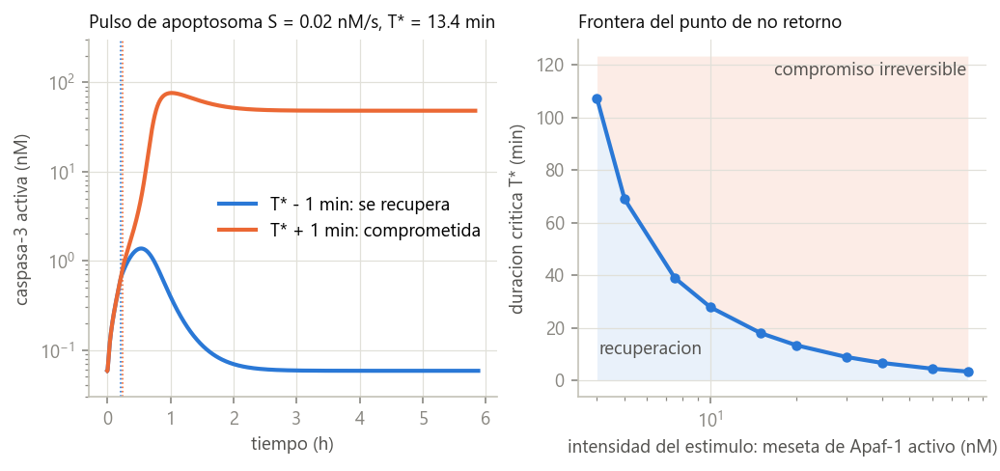
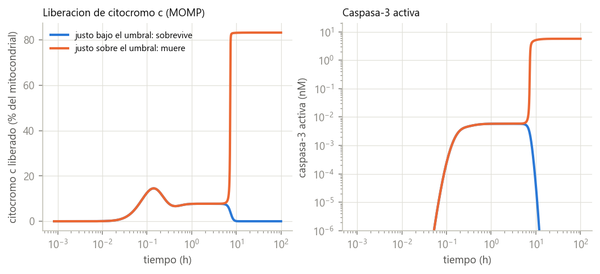
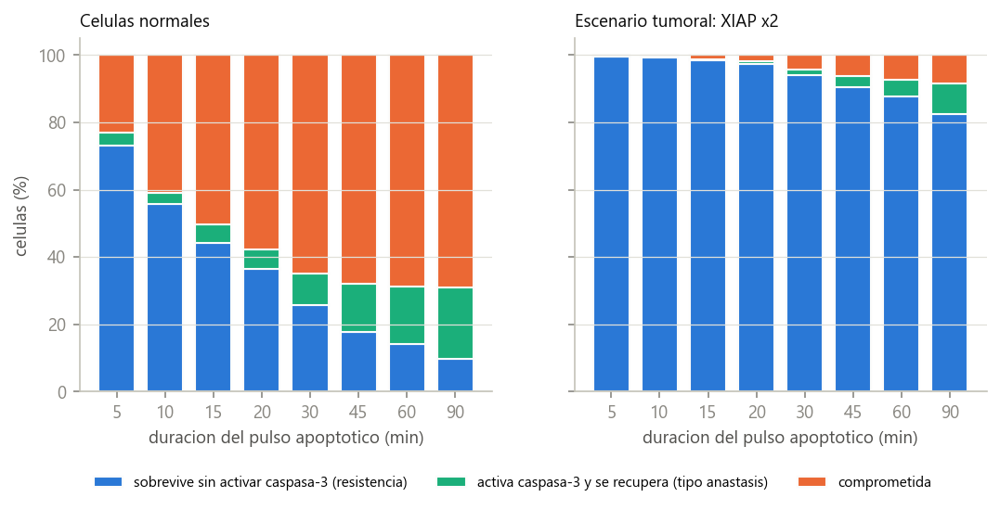

# Paper_Molecular

### ¿Dónde está el punto de no retorno celular? Reversibilidad de la apoptosis y anastasis en modelos mecanísticos publicados

[](LICENSE)
[](LICENSE-DOCS.md)


Proyecto de investigación doctoral en biomedicina computacional. Estudia en qué momento una célula
dañada deja de poder recuperarse (*punto de no retorno celular*, CPNR) y qué determina ese punto.
Presta especial atención a la **anastasis**: la recuperación de células que ya habían activado las
caspasas de la apoptosis. Es un fenómeno deseable en células sanas y peligroso en tumores.

> **Estado.** Manuscrito en preparación, no revisado por pares. Los resultados numéricos proceden de
> simulaciones (`data_provenance = SIMULATED`), salvo el contraste con datos públicos de GEO, cuyo resultado
> fue **no concluyente**. Cada cifra puede rastrearse a un archivo de este repositorio.

*English summary.* This repository contains a computational study of the apoptotic point of no return and
anastasis. A transient-stimulus/withdrawal protocol is simulated in three published mechanistic models
(Legewie 2006 and Albeck 2008, curated in BioModels; Bagci 2006, non-curated and verified against its article)
without changing any published constant, plus a pre-registered test on public anastasis transcriptomes
(GEO GSE90959). Documents are in Spanish; the manuscript includes an English abstract.

---

## Documentos principales

| Documento | Contenido |
|---|---|
| **[Artículo científico — `articulo_CPNR_borrador.md`](Documentacion/articulo_CPNR_borrador.md)** | Borrador principal del artículo asociado al proyecto. Incluye resumen (español e inglés), introducción, métodos, resultados (3 tablas, 8 figuras), discusión con predicciones contrastables, limitaciones, conclusiones, declaración de uso de IA y 24 referencias verificadas en Europe PMC, Crossref o el texto original. |
| **[Resultados de simulación — `simulacion_cpnr_resultados.md`](Documentacion/simulacion_cpnr_resultados.md)** | Informe de los resultados, análisis y conclusiones de las simulaciones CPNR. Detalla cada experimento (E1–E5 en el interruptor de caspasas, M0–M4 en el módulo mitocondrial y el contraste con GSE90959), clasifica cada afirmación por nivel de evidencia (experimental, computacional, inferencia, hipótesis) y, en la sección 7, da la trazabilidad completa: SHA-256 de modelos, datos y código, versiones de software e indicación de en qué archivo y columna está cada cifra. |

Documentos de apoyo:
- [`preregistro_GSE90959.md`](Documentacion/preregistro_GSE90959.md): hipótesis, genes y prueba fijados **antes** de analizar los datos reales.
- [`research/models/sbml/README.md`](research/models/sbml/README.md): procedencia de cada modelo, verificación y motivo del descarte de Eissing 2004.
- [`modelo_cpnr.md`](Documentacion/modelo_cpnr.md), [`arquitectura_ia.md`](Documentacion/arquitectura_ia.md), [`paper1_paper2_framework.md`](Documentacion/paper1_paper2_framework.md), [`DIGITAL_TWIN_README.md`](Documentacion/DIGITAL_TWIN_README.md): marco conceptual del proyecto doctoral.
- [`analisis.md`](Documentacion/analisis.md): fichas de análisis de la bibliografía.

---

## Problema y objetivo científico

Tradicionalmente, la apoptosis se considera irreversible una vez que se libera el citocromo c (MOMP) y se
activan las caspasas efectoras. Sin embargo, se ha observado experimentalmente que células con
fragmentación mitocondrial, activación de caspasa-3 y daño en el ADN se recuperan al retirar el estímulo
(Tang et al. 2012). Algunas quedan con daño genómico.

El objetivo es determinar, con modelos mecanísticos publicados y sin modificar sus constantes:

1. cuánta caspasa-3 activa es compatible con la recuperación;
2. si la MOMP completa es el punto de no retorno;
3. qué parámetros desplazan ese punto, en particular los inhibidores sobreexpresados en tumores (XIAP, Bcl-2);
4. si una hipótesis derivada de las simulaciones se observa en datos transcriptómicos públicos de anastasis.

El proyecto está planteado como dos artículos: (1) predicción del punto de no retorno y (2) distinción entre
recuperación segura y anastasis tumoral ([marco](Documentacion/paper1_paper2_framework.md)). Este repositorio
contiene el primer manuscrito completo.

## Metodología

- **Modelos** (archivos SBML de BioModels, usados sin modificar; las ecuaciones se leen directamente del SBML con libsbml):

  | Modelo | BioModels | Estado | Uso |
  |---|---|---|---|
  | Legewie et al. 2006: caspasa-9/caspasa-3/XIAP | BIOMD0000000102 / 103 | Curado | E1–E5 |
  | Albeck et al. 2008 (EARM): vía extrínseca con MOMP | BIOMD0000000220 | Curado | M0 |
  | Bagci et al. 2006: Bax/Bcl-2, poros y recambio proteico | MODEL1006230056 | **No curado**, verificado frente a 4 cifras de su artículo (diferencia máxima 1.4 %) | M1–M4 |

- **Protocolo:** estímulo apoptótico transitorio seguido de su retirada, análogo a los experimentos de anastasis.
  El punto de no retorno se define como la frontera entre las cuencas de atracción del estado vivo y del apoptótico.
- **Análisis:** bisección de la duración o intensidad crítica; sensibilidad local y global (1500 juegos de
  parámetros en Legewie y 1000 en Bagci); variabilidad célula a célula (Monte Carlo); predicción del destino con
  regresión logística y bosque aleatorio validados por grupos.
- **Datos reales:** contraste pre-registrado en GEO GSE90959 (hepatocitos de ratón, etanol y recuperación),
  con nulo empírico y corrección de Holm.
- **Bibliografía:** catálogo de 475 publicaciones con PMID/DOI verificados y flujo PRISMA (pipeline en `src/`).

## Principales resultados

Resumen tomado del [artículo](Documentacion/articulo_CPNR_borrador.md) y del [informe](Documentacion/simulacion_cpnr_resultados.md); allí están las cifras completas y sus fuentes.

- **El punto de no retorno se cruza con muy poca caspasa-3 activa.** En el modelo de Legewie se cruza con
  un 0.2–1.0 % de la caspasa-3 activa, y ninguna célula que se recupera supera el 2.7 %. Con el estímulo nominal,
  la duración crítica es de 13.4 min.
- **Un punto de no retorno y la recuperación tras activación sustancial rara vez coexisten:** solo 5 de los
  257 juegos de parámetros con punto de no retorno (1.9 %) permiten recuperarse tras activar más del 10 % de la caspasa-3.
- **En una población heterogénea, el cociente XIAP:caspasa-3 de cada célula decide quién se recupera.**
  Con un pulso de 90 min, se recupera tras activar caspasa-3 el 0 % de las células del quintil inferior del
  cociente y el 52 % del superior.
- **Duplicar XIAP genera sobre todo resistencia, no anastasis:** la mayoría de las supervivientes nunca llega a activar caspasa-3.
- **La MOMP completa no es el punto de no retorno.** En el modelo de Bagci, una célula sobrevive tras liberar
  hasta el 14.5 % de su citocromo c, y hasta el 33 % si se multiplica por 8 la producción de Bcl-2. En el muestreo
  global, la MOMP sobrevivible tuvo una mediana del 1.5 % y un percentil 90 del 28.7 %.
- **Albeck 2008 no puede representar la anastasis:** el modelo no tiene procesos de reversión, así que inhibir la caspasa-8 solo retrasa la muerte.
- **Datos reales: no concluyente.** En GSE90959 no apareció el desplazamiento transcripcional hacia los
  inhibidores planteado en el pre-registro. Además, Xiap, Casp3 y Casp9 no superaron el umbral de expresión de la plataforma.

| Punto de no retorno (Legewie) | MOMP parcial sobrevivible (Bagci) |
|---|---|
|  |  |



*Figuras generadas por `run_cpnr_simulations.py` y `run_momp_simulations.py`. Todas en [`research/figures/`](research/figures/).*

**Limitaciones principales** (lista completa en el artículo):
- Los modelos no incluyen la ejecución de la muerte, la reparación ni la muerte independiente de caspasas tras la MOMP.
- El modelo de Bagci no está curado.
- La variabilidad celular (CV 0.25) es un supuesto.
- El contraste con datos reales se limitó a un conjunto bulk y no pudo probar la predicción de célula individual.

---

## Estructura del repositorio

Se mantiene la estructura original del proyecto para no romper las rutas que citan los documentos.

```
Paper_Molecular/
├── README.md                  este archivo
├── LICENSE                    MIT (código)
├── LICENSE-DOCS.md            CC BY 4.0 (documentos, figuras y resultados)
├── CITATION.cff               metadatos de citación
├── CONTRIBUTING.md            reglas científicas y flujo de contribución
├── requirements.txt           dependencias
├── Documentacion/             documentos científicos (artículo, informe, pre-registro, marco, catálogos)
├── Articulos_libros/          catálogos bibliográficos (CSV/XLSX); los PDF no se publican
├── src/                       pipeline bibliográfico (búsqueda, verificación PMID/DOI, retractaciones, PRISMA)
└── research/
    ├── models/sbml/           modelos SBML de BioModels + README de procedencia
    ├── models/{pysb,bionetgen,physicell}/   plantillas vacías de fases futuras
    ├── src/simulation/        simulaciones (cargador SBML, E1–E5, M0–M4)
    ├── src/evaluation/        contraste con datos reales (GSE90959)
    ├── data/download_geo.py   descarga y verificación de los datos de GEO
    ├── data/external/         ejemplo sintético SOLO para validar el esquema (no son datos)
    ├── results/simulations/   tablas de resultados de las simulaciones (SIMULATED)
    ├── results/real_data/     resultados del contraste con GSE90959 (REAL/DERIVED)
    ├── figures/               figuras del artículo
    └── tests/                 11 tests de reproducción
```

Correspondencia con una estructura estándar: `docs/` → `Documentacion/`; `papers/` → `Documentacion/articulo_CPNR_borrador.md`;
`src/` → `research/src/` (simulaciones) y `src/` (bibliografía); `results/`, `figures/` y `data/` → `research/`.
No hay notebooks: todo se ejecuta con scripts.

## Scripts: qué ejecuta cada uno

Orden recomendado (los comandos de `python -m` se ejecutan desde `research/src`):

| # | Script | Qué hace | Entradas | Salidas | Tiempo aprox. |
|---|---|---|---|---|---|
| 1 | `research/tests/` (`pytest`) | Comprueba que los modelos reproducen sus artículos y las cifras de referencia | `research/models/sbml/` | — | ~15 s |
| 2 | `python -m simulation.run_cpnr_simulations` | E1–E5: histéresis, punto de no retorno, sensibilidad local y global, poblaciones, predicción | BIOMD0000000102/103 | `research/results/simulations/E*.csv`, `summary.json`, `research/figures/E*.png` | 4–7 min |
| 3 | `python -m simulation.run_momp_simulations` | M0–M4: rescate en Albeck, verificación de Bagci, MOMP sobrevivible, escenarios Bcl-2/IAP/Bax, muestreo global | BIOMD0000000220, MODEL1006230056 | `research/results/simulations/M*.csv`, `summary_momp.json`, `research/figures/M*.png` | ~14 min |
| 4 | `python research/data/download_geo.py` (desde la raíz) | Descarga GSE90959 (y GSE86480) de GEO y verifica sus SHA-256 | NCBI GEO | `research/data/raw/` | < 1 min |
| 5 | `python -m evaluation.gse90959_brake_driver` | Contraste pre-registrado frenos−impulsores | `research/data/raw/GSE90959/` | `research/results/real_data/`, `research/figures/D1_*.png` | < 1 min |

Módulos de apoyo: `sbml_ode.py` (carga SBML con reacciones o *rate rules*) y `cpnr_core.py` (protocolo de pulso y retirada, destino, T\*).
Otros scripts de `research/src/` (`run_validation.py`, `dataset_search.py`, `*_hooks.py`, `models/`, `pipeline/`, `preprocessing/`)
son estructura de fases futuras. `run_validation.py` se niega a ejecutarse sin un dataset real y no produce resultados.

**Pipeline bibliográfico (`src/`).** Requiere red y consulta servicios externos (OpenAlex, Crossref, Europe PMC,
PubMed), así que una nueva ejecución puede dar resultados distintos si esas bases cambian.

| Script | Función |
|---|---|
| `search_articles.py` | Búsqueda en OpenAlex y puntuación de relevancia |
| `enrich_metadata.py`, `metadata.py` | Enriquecimiento de metadatos (Europe PMC, PMC) |
| `deduplicate.py` | Detección de duplicados |
| `classify_biomedical.py` | Clasificación biomédica y depuración del catálogo |
| `verify_ids.py` | Verificación de PMID y DOI (Crossref, PubMed) |
| `check_retractions.py` | Búsqueda de retractaciones (Crossref) |
| `download_open_access.py` | Descarga de PDF de acceso abierto (no se publican) |
| `reconcile_manual_library.py`, `fix_manual_titles.py`, `organize_library.py` | Conciliación de la biblioteca manual |
| `build_catalog.py`, `build_analysis.py`, `build_auxiliary_outputs.py` | Catálogos, fichas de análisis, PRISMA y análisis de brechas |
| `inventory_project.py` | Inventario local de archivos (su salida no se publica) |

El orden histórico de ejecución de este pipeline no quedó documentado en el proyecto original. Sus salidas están en `Documentacion/` y `Articulos_libros/`.

## Reproducibilidad

**Requisitos técnicos:** Python 3.10 (los resultados se generaron con 3.10.0 en Windows 11). Se necesita
conexión a internet solo para descargar los datos de GEO y para el pipeline bibliográfico. No se necesita GPU;
las simulaciones usan todos los núcleos de CPU disponibles en los pasos paralelos.

**Librerías** (versiones exactas en [`requirements.txt`](requirements.txt)): numpy 1.26, scipy 1.11, pandas 2.0,
matplotlib 3.10, scikit-learn 1.7, python-libsbml 5.21, pytest; y para la bibliografía: requests, PyMuPDF, lxml, openpyxl.

**Instalación:**

```bash
git clone https://github.com/WuilsonEstacio/Paper_Molecular.git
cd Paper_Molecular
python -m venv .venv
# Windows: .venv\Scripts\activate    Linux/macOS: source .venv/bin/activate
pip install -r requirements.txt
```

**Ejecución completa, en orden:**

```bash
cd research && python -m pytest tests -q && cd ..             # 1. verificación (11 tests)
cd research/src
python -m simulation.run_cpnr_simulations                     # 2. E1–E5
python -m simulation.run_momp_simulations                     # 3. M0–M4
cd ../..
python research/data/download_geo.py                           # 4. datos de GEO (+ verificación SHA-256)
cd research/src && python -m evaluation.gse90959_brake_driver  # 5. contraste con datos reales
```

**Resultados esperados:** las tablas en `research/results/simulations/` y `research/results/real_data/`, y las
figuras en `research/figures/`. Las semillas son fijas (42, 43, 44 y 2026), así que con las mismas versiones
los resultados deben coincidir con los publicados. La [sección 7 del informe](Documentacion/simulacion_cpnr_resultados.md#7-trazabilidad-y-reproducibilidad)
lista los SHA-256 de modelos, datos y código, y en qué archivo y columna está cada cifra del artículo.

## Principios del proyecto

- No se inventan constantes cinéticas: solo parámetros publicados y verificables.
- Todo resultado se etiqueta `REAL`, `SIMULATED` o `DERIVED`. Los datos simulados no se presentan como evidencia experimental.
- Los contrastes con datos reales se pre-registran y los resultados negativos se informan.
- Un resultado previo de rendimiento perfecto (AUC = 1.0) se obtuvo con 6 filas sintéticas escritas a mano.
  Se puso en cuarentena y **no se publica**.

## Autor

**Wuilson Adolfo Estacio Rojas** — GitHub: [@WuilsonEstacio](https://github.com/WuilsonEstacio)

El código, las simulaciones, la verificación bibliográfica y el borrador del artículo se desarrollaron con
asistencia de un modelo de lenguaje (Claude, Anthropic), bajo la dirección del autor. Ver la declaración en el artículo.

## Licencia

- Código: [MIT](LICENSE).
- Documentos, figuras y tablas de resultados: [CC BY 4.0](LICENSE-DOCS.md).
- Modelos SBML de terceros: términos originales de BioModels (CC0).
- Los artículos de la bibliografía no se redistribuyen.

## Citation

Si usa este repositorio, cítelo así (metadatos en [`CITATION.cff`](CITATION.cff)):

> Estacio Rojas, W. A. *Paper_Molecular: punto de no retorno celular (CPNR) y anastasis en modelos mecanísticos publicados* [software y documentación]. GitHub. https://github.com/WuilsonEstacio/Paper_Molecular

```bibtex
@software{estacio_rojas_paper_molecular,
  author = {Estacio Rojas, Wuilson Adolfo},
  title  = {Paper_Molecular: punto de no retorno celular (CPNR) y anastasis en modelos mecanísticos publicados},
  url    = {https://github.com/WuilsonEstacio/Paper_Molecular}
}
```

El repositorio aún no tiene DOI ni publicación asociada. Cuando existan se añadirán aquí y en `CITATION.cff`.
Si usa los modelos, cite también sus artículos originales (Legewie et al. 2006; Albeck et al. 2008; Bagci et al. 2006)
y, si usa los datos, a Tang et al. 2022 (GSE90959). Las referencias completas están en el artículo.
